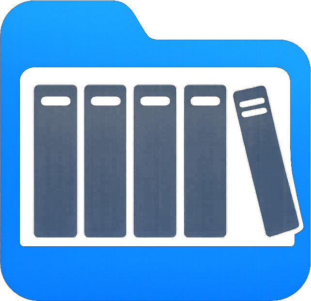
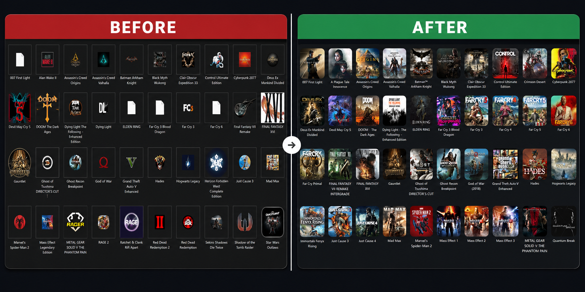

# Game Icons Studio

### From generic icons to a game shelf.

Automatically replace plain Windows game and application icons with high-quality artwork.

---

## What is Game Icons Studio?

If you keep your game and app shortcuts in Windows folders, they can end up with plain, inconsistent, or low-quality icons. **Game Icons Studio** scans your shortcuts, helps find appropriate artwork, creates crisp multi-size Windows `.ico` files, and applies the icons for you.

It runs locally on your PC. The interface opens in your browser, but it is a local application served from `localhost`, not a hosted website.

## 🎬 See it in action

▶️ *Click to watch a quick walkthrough on YouTube*

## Before & After

## Features

- 🎮 **Game artwork matching** — search SteamGridDB for game artwork and review candidates before applying.
- 🧩 **Program & app icons** — scan application shortcuts and search for brand/software icon candidates, with a batch preview so you can review the results.
- 🔎 **Image search shortcuts** — open Google Images or Yandex Images with useful search terms when you want more choices.
- 🖼️ **Bring your own artwork** — select an image from disk, drag and drop it, paste with Ctrl+V, or load it from an image URL.
- ✨ **Multi-size Windows icons** — convert artwork into Windows `.ico` files with multiple sizes.
- 📁 **Folder icons** — customize folder icons through Windows `desktop.ini`.
- 🗂️ **Other files and scripts** — for file types that do not support a custom icon directly, create a companion custom-icon shortcut without modifying the original file.
- ↩️ **Undo / Restore** — create restore points before applying changes and restore supported shortcut/folder icon states.
- 🎨 **Aurora Glass** — the default visual theme, with additional themes available.
- 🧰 **Icon cache repair**, searchable history, quick re-apply, and detection of newly added shortcuts.

## What's new in v6.30–v6.35

This section supplements the original introduction above. The screenshots, demo, and project overview are intentionally retained.

<strong>v6.35 — Release packaging and automation</strong>

- Added a manually triggered GitHub Actions workflow to build clean release packages.
- Builds a full ZIP for new users and an overlay-upgrade ZIP for existing installations.
- Adds a SHA-256 checksum manifest and release validation checks.
- Added optional issue-reply automation; it is deliberately disabled by default.
- Release archives exclude API keys, user settings, caches, generated icons, downloaded artwork, logs, history, and restore-point backups.

<strong>v6.34 — Program-icon search improvements</strong>

- Uses executable metadata such as product name, company, and file description to improve program search queries.
- Adds structured brand/software icon candidates from Iconify.
- Improves relevance scoring and avoids letting image dimensions alone dominate the match score.
- Converts supported SVG candidates to PNG for the existing Windows icon pipeline.
- Uses more conservative automatic matching when confidence is low.

<strong>v6.33 — Broader image discovery</strong>

- Adds complementary Google Images and Yandex Images searches for program icons.
- Combines multiple candidate queries and ranks available results by relevance hints, square ratio, and resolution.
- Retains manual search, local-image selection, drag-and-drop, and clipboard paste as fallbacks.

*Search-engine HTML can change or be restricted, so image discovery is best-effort. Always review results before applying them.*

<strong>v6.30–v6.32 — Restore, custom artwork, and interface fixes</strong>

- Added local image selection and a workflow to use personal artwork for icon conversion.
- Added drag-and-drop, clipboard paste, image URL input, and alternative image-search shortcuts.
- Added restore points with configurable retention and restoration of supported previous icon states.
- Expanded folder icon customization and target selection.
- Fixed readability of the Undo / Restore “Keep restore points” dropdown across themes.
- Set Aurora Glass as the default theme for fresh browser profiles.

For the complete version history, see **[CHANGELOG-v6.35.md](CHANGELOG-v6.35.md)**. The latest published download is available from [GitHub Releases](https://github.com/YellowRed1705/game-icons-studio/releases/latest).

## Requirements

- Windows 10 or 11
- PowerShell 7+ recommended; Windows PowerShell 5.1 fallback is available
- A free SteamGridDB API key for SteamGridDB game matching

Local images and available executable-icon fallbacks can be used without a SteamGridDB key.

## How to use

1. Download the [latest release ZIP](https://github.com/YellowRed1705/game-icons-studio/releases/latest).
2. Right-click the ZIP, open **Properties**, check **Unblock** if shown, and extract it.
3. Double-click `Game Icons Studio.bat`.
4. Follow the setup prompts and configure your SteamGridDB key if you want to use game matching.
5. Choose the shortcuts/folder mode, review the suggested icons, adjust any candidates you dislike, and apply the changes.

For an existing installation, use the **Upgrade ZIP** attached to the latest release and extract it directly over the existing program folder.

## Is it safe?

- Game Icons Studio is designed to run locally.
- For shortcuts, it changes the shortcut icon rather than the installed application itself.
- For ordinary files that cannot have their Explorer icon changed directly, it creates a companion `(Custom Icon).lnk` shortcut; the original file is not modified.
- Folder customization uses Windows folder icon configuration files. Review the target folder before applying changes.
- Restore points can help revert supported changes, but older changes made before a restore point existed cannot be recovered automatically.
- Only download release ZIPs from this repository. The project is open source so you can inspect its code.

The local interface uses internet access for external artwork/search providers when those features are used. Google, Yandex, Iconify, and SteamGridDB may change their availability or response formats, so automatically discovered results should always be reviewed.

## FAQ

**Does it work with Steam, Epic Games, GOG, and other launchers?**

It works with Windows shortcuts (`.lnk`) from any launcher. Icon choice depends on the available artwork sources and the match quality.

**Does it change my games or installed programs?**

For normal shortcuts, it changes the shortcut's icon. For file types that do not support custom icons directly, it can create a companion shortcut. Folder icon customization changes the folder's icon configuration.

**Why does it open in my browser?**

The browser is the interface for a local app served from your own PC through `localhost`; it is not a public website.

**Why was an automatic icon not found?**

Image discovery depends on accessible search results and matching metadata. Use the preview to select an alternative, search Google/Yandex manually, or choose a local image.

## Contributing

Ideas, bug reports, and pull requests are welcome. Please open an [issue](https://github.com/YellowRed1705/game-icons-studio/issues).

## License

Released under the [MIT License](LICENSE). Free to use, modify, and share.

## Acknowledgements

- Artwork and game data from the [SteamGridDB](https://www.steamgriddb.com/) community.
- Software/brand icon candidates may be sourced from [Iconify](https://iconify.design/).
- This is an independent project and is not affiliated with or endorsed by SteamGridDB, Valve, Google, Yandex, Iconify, or any game publisher.

---

If you find Game Icons Studio useful, consider starring ⭐ the repository. Thank you for supporting the project!

