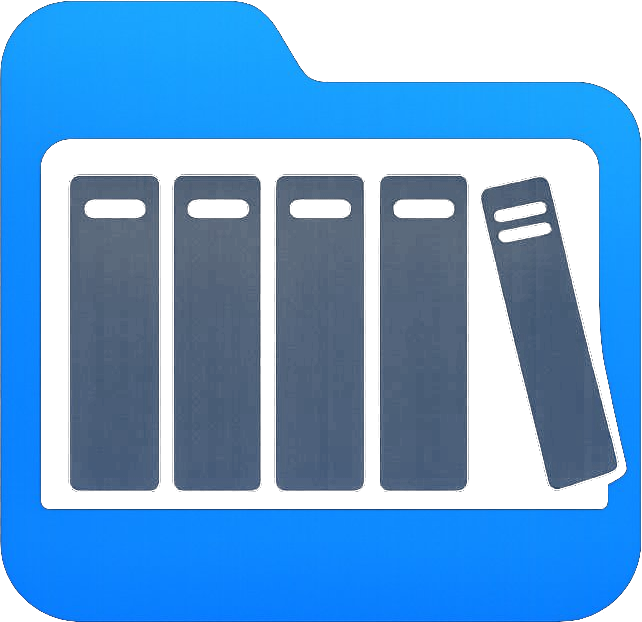
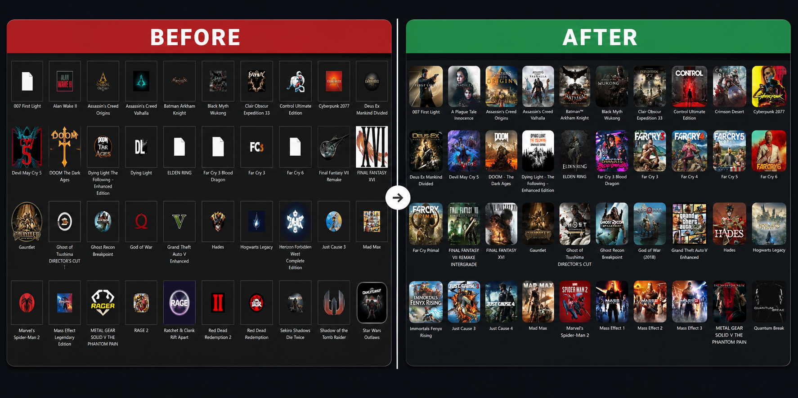

# Game Icons Studio v6.48

### From generic icons to a game shelf.

Automatically replace plain Windows game and application shortcut icons with high-quality artwork.

---

## What is this?

If you keep a folder of game and application shortcuts on Windows, they can end up with plain, mismatched icons. **Game Icons Studio** scans your shortcuts, helps find suitable artwork, builds clean Windows icons, and applies them — turning a messy folder into a tidy icon shelf.

It runs locally on your PC. The interface opens in your web browser, but it is **not** a hosted website — it is a local tool served from your own computer.

## 🎬 See it in action

▶️ *Click to watch a quick walkthrough on YouTube*

## Before & After

## Features

- 🎮 **Game artwork matching** — finds candidate game artwork through SteamGridDB and lets you review results before applying.
- 🗂️ **Game Library scan** — recursively inspect `.lnk`, registered `.url` launcher links, `.exe`, `.bat`, `.cmd`, and common emulator ROM formats. Create normal Windows `.lnk` shortcuts, reuse existing launchers, and keep original game files untouched.
- 🪟 **Maximized, focused Windows dialogs** — native folder/file pickers and post-apply Explorer windows are restored, maximized, and brought to the foreground; Explorer opens in Large Icons view.
- 🌐 **Three-language interface** — switch between English, Türkçe and العربية with a compact selector using bundled SVG flags. Fresh installs default to English; the selected language is remembered.
- 🗺️ **Localized workflow** — setup, scans, restore, repair, image search, progress, help and picker captions are translated throughout the interface.
- 🧩 **Program & app icons** — keep the embedded application icon as a safe fallback, or open Google Images / Yandex Images and drop your chosen image into the custom editor.
- 🔎 **Image search shortcuts** — open Google Images or Yandex Images for additional options.
- 🖼️ **Use your own artwork** — select an image from disk, drag and drop it, paste it with Ctrl+V, or load it from an image URL.
- ✨ **High-quality Windows icons** — convert artwork into multi-size `.ico` files.
- 📁 **Folder icons** — customize folder icons through Windows `desktop.ini`.
- ↩️ **One-click Undo** — restore the latest saved icon transaction, including restoring converted `.url` sources and removing newly generated shortcut links.
- 🛠️ **Broken-icon repair** — inspect shortcut ICO references, relink valid saved ICOs, rebuild from cached artwork when possible, and refresh the Windows icon cache.
- 🗂️ **Quick re-apply and history** — revisit previous work and quickly re-apply supported changes.
- 🧰 **Icon-cache repair** — help refresh blank or stale icons displayed by Windows.
- 🎨 **Multiple themes** — Aurora Glass is the default theme, with other themes available.

## What's new in v6.30–v6.48

These release notes are an addition to the original introduction above. The logo, demo, before-and-after image, and original page structure are retained.

<strong>v6.48 — PowerShell 7.7 embedded-icon scan crash fix</strong>

- Fixes the Game Library scan crash when an application uses its embedded EXE/ICO icon as the fallback artwork.
- Converts the fallback artwork collection from Generic.List[object] to a plain object array before building the JSON response. This avoids the PowerShell 7.7 "Argument types do not match" exception.
- Adds a regression check for the fallback collection and its JSON round-trip.
- Preserves existing shortcut data, saved artwork choices, restore points and the normal Review/Apply workflow.

<strong>v6.47 — simpler Google/Yandex image search and instant drag-and-drop</strong>

- Removes the unreliable automatic Top 5 fetch flow and its background Google/Yandex scraping.
- Keeps Google Images and Yandex Images as two separate, clearly visible search buttons in the first icon-editing screen.
- Clicking either button opens its image search in a new tab and highlights the app's drop zone, ready for a direct drag-and-drop.
- Hides the empty crop editor until an image is loaded, keeping the drop zone and preview visible without unnecessary scrolling.
- Retains local image browsing, Ctrl+V clipboard paste, square crop controls, and the existing ICO styling pipeline.
- Program scans no longer attempt background web-image collection; the embedded application icon remains the safe fallback until the user chooses a replacement.

<strong>v6.46 — automatic Top 5 image selection and interactive crop editor</strong>

- Fetches the top five candidate images from Google Images and the top five from Yandex Images in separate result groups.
- Balances the merged search queue so one provider cannot crowd the other out.
- Adds one-click Fetch & Apply: download the original image through the local app endpoint, prepare a square preview and add it to the current item.
- Adds Crop first for manual review before applying an image.
- Adds an interactive square crop selector with mouse/touch drag selection, move, zoom in/out and reset.
- Sends the selected square crop through the existing ICO conversion and shared CornerRadius/Border/Shadow styling pipeline.

<strong>v6.45 — compact, no-scroll home dashboard</strong>

- Reworks the eight primary home actions into a consistent four-column, two-row desktop dashboard.
- Reduces card height, padding, icon size and vertical spacing so the main choices fit on a typical desktop screen without scrolling.
- Keeps descriptions to three visible lines, with responsive layout retained.
- Uses a two-column, touch-friendly layout on smaller screens and a shorter-height layout on compact displays.

<strong>v6.44 — one-flag language switcher and manual game selection</strong>

- Replaces the three visible language buttons with one compact flag button. Click to cycle English → Turkish → Arabic → English; the current language remains saved in this browser.
- Adds a direct Change Game action on each game tile in the review grid.
- Expands the wrong-match screen with manual SteamGridDB game-title search, using the API key already stored in the current browser.
- Keeps the automatic candidate list available as built-in alternatives.
- Adds a custom game-title path for titles missing from SteamGridDB. Choose a cover via Google Images, Yandex Images, URL, drag-and-drop, clipboard or a local image.
- Stores the chosen artwork title separately from the original Shortcut name and launch command.

<strong>v6.43 — emulator app icons are included in Game Library scans</strong>

- Fixes the Game Library filter that treated plain emulator launcher shortcuts as helper utilities and excluded them from artwork matching.
- Cemu, Eden, Ryujinx and Ryubing shortcuts without ROM launch arguments now enter the scan as Program & App Icons items. ROM/game shortcuts with arguments remain game entries.
- Keeps emulator profiles available for generated ROM shortcuts, so the detection change does not rewrite ROM launch targets or arguments.
- Adds item-level search and apply modes: emulator launchers use software/brand artwork and embedded-icon fallback, while game shortcuts continue using SteamGridDB game artwork.
- Adds Windows regression tests for Cemu, Eden and Ryubing.

<strong>v6.42 — per-browser API keys and matching-flow repair</strong>

- Stores each user's SteamGridDB API key only in that user's browser profile `localStorage` under `gis-sgdb-api-key`. The key is validated when the app starts and is sent to the local server in a request header only when needed.
- Removes the legacy `ApiKey` property from `settings.json` on load, automatically cleaning old disk-based copies. The API key is never written to `settings.json`, application logs, release archives, or GitHub source files.
- Classic CMD mode prompts for a key for the current run only; it no longer persists the key to disk.
- Corrects the keyless entry flow: Continue without a key is limited to Program & App Icons and other non-SteamGridDB image workflows. Game, folder and game-file matching require a valid key and cannot silently create Placeholder-only runs because a key is missing.
- Validates a stored browser key against SteamGridDB on every launch. Invalid or revoked keys are removed from localStorage and the setup screen is shown again.
- Adds an explicit storage notice to the API setup screen and masks the API key input.
- Adds backend checks to prevent game-artwork scan requests from proceeding without a validated key.

<strong>v6.41 — JavaScript recovery, persistent SVG flags and foreground picker ownership</strong>

- Fixes the malformed English, Turkish and Arabic operational-message dictionaries that prevented the browser JavaScript from parsing. This was the root cause of the unresponsive UI buttons.
- Adds missing locale-object separators and removes malformed/duplicate message properties. The complete embedded browser script now passes the JavaScript syntax check.
- Replaces emoji-dependent language flags with inline SVG flags for the United Kingdom, Türkiye and Saudi Arabia. The icons are bundled in the UI, stay crisp at small sizes and do not depend on system emoji fonts or external image hosts.
- Keeps the language selector LTR and accessible even when Arabic RTL mode is active. The selector remains visible and uses explicit flag dimensions.
- Moves the language preference to `gis-lang-v3` so an old saved Arabic preference cannot override the requested English-first default on the first v6.41 launch. New selections are remembered normally.
- Captures the foreground browser window handle when a folder or multi-file picker is requested, then passes it to the native Common Item Dialog running on its STA thread. The picker can now restore/maximize itself relative to its real owner instead of guessing the foreground window from the worker thread.
- Keeps the post-apply Explorer window in Large Icons view and explicitly restores, maximizes and foregrounds the matching folder window.

<strong>v6.40 — Foreground Windows dialogs and EN / TR / AR interface</strong>

- Maximizes and focuses the native Windows Common Item Dialog when folder or multi-file selection starts. The owning browser window is restored only when minimized; the picker is brought to the foreground rather than left minimized or behind other windows.
- Opens the post-apply Explorer folder maximized and focused, then sets its view to Large Icons so the changed artwork is visible immediately.
- Replaces the single English/Arabic text-toggle with a compact flag-based EN / TR / AR language selector. English is the default for fresh installs; language choice is saved independently from the legacy `gis-lang` key.
- Adds complete Turkish translations while preserving established technical terms such as `Shortcut`, `Icon`, `ROM`, `Launcher`, `Preview`, `Grid`, `Apply`, `Restore Point`, and `Cache` in English.
- Expands Arabic and English screen coverage and localizes operational messages, scan counters, estimated duration, game-library summaries, repair results, image candidate metadata, themes, picker titles and accessibility labels.
- Re-renders data-driven screens such as History, Restore Points, Report, matching and artwork Preview when the language changes.
- Adds Windows CI source-contract checks for the foreground/maximize window helpers, Explorer behavior, language switcher, default-English preference and localized picker wiring.

<strong>v6.39 — Game Library, launcher conversion, modern dialogs and repair</strong>

- Makes **Game Library Folder** the primary home-screen workflow so a selected library folder is scanned for existing .lnk shortcuts, .url Internet Shortcuts, .exe, .bat, .cmd, and common emulator ROM file types.
- Converts recognized Steam, Epic Games, Ubisoft Connect, Battle.net, EA and other registered protocol .url launchers into verified, standard Windows .lnk files. The original .url is retained until the replacement has an icon and the restore transaction is safely recorded.
- Detects emulator executable shortcuts already present inside the selected folder and uses known profiles for Cemu, Ryujinx/Eden/Yuzu, Dolphin, mGBA, melonDS, Azahar/Citra and PCSX2 when building ROM launch links. If a matching emulator is not found, the ROM shortcut uses its registered Windows file association.
- Reuses existing shortcuts and detects executable targets already represented by a shortcut to avoid duplicates. Filters common installers, uninstallers, crash reporters and launcher utility applications from game matching. Each scan is capped at 1,000 launchable entries.
- Replaces legacy folder/file dialogs with the native Windows Explorer-style Common Item Dialog.
- Adds **Undo Last Change** and makes converted launcher links reversible: the backup restores the original .url and removes newly created .lnk files.
- Adds **Repair Broken Icons**, which checks .lnk ICO references, relinks valid icons from the persistent Icons folder, rebuilds missing icons from cached artwork when available, and refreshes Windows Explorer.
- Keeps the legacy **Shortcuts Only** mode available as a separate option.

<strong>v6.38 — Restore Game Files Folder workflow</strong>

- Adds a dedicated **Game Files Folder** action to the home screen.
- Recursively finds existing `.lnk` shortcuts, `.url` launcher links, `.exe` files, and `.bat`/`.cmd` launchers in a selected game folder.
- Reuses an existing shortcut when it already targets the executable, avoiding duplicate links.
- Converts `.url` launcher entries to standard `.lnk` shortcuts only after a new link has been created successfully; failed conversions keep the original `.url`.
- Creates companion custom-icon `.lnk` shortcuts beside eligible executable and script files. Original `.exe`, `.bat`, and `.cmd` files are never modified.
- Skips common installers, uninstallers, crash reporters, and redistributable helpers, and limits one scan to 1,000 launchable entries as a safety cap.
- Automatically matches games through the existing SteamGridDB review/apply flow and keeps the full results reviewable before applying icons.

<strong>v6.37 — Real-time operation progress</strong>

- Replaces the fake timer-driven apply progress bar with a live stream of progress events from the actual Windows icon pipeline.
- Shows the true completed/total artwork downloads (for example, **57 / 59 · 96%**) and the last item being processed.
- Shows real per-phase progress for downloads, icon building, restore-point creation, shortcut updates, and Windows Explorer refresh.
- Uses a streamed, flushed response so the browser can update while the operation is still running.
- Reports safety-backup failures accurately and keeps the interface from claiming success when the update was stopped.

<strong>v6.36 — Faster cover previews</strong>

- Replaces eager-loading every cover with a prioritized, progressive thumbnail queue.
- Loads the selected cover and nearby visible previews first, with at most four cover requests managed by the UI at once.
- Defers off-screen thumbnails until they approach the visible area.
- Cancels queued and active preview work when leaving the cover picker, so old thumbnails do not compete with the next screen.

<strong>v6.35 — Release packaging and automation</strong>

- Added a manually triggered GitHub Actions workflow to create release packages.
- Builds a full ZIP for new users and an overlay-upgrade ZIP for existing installations.
- Adds a SHA-256 checksum manifest and release validation checks.
- Added optional, duplicate-safe replies to feature requests #1 and #2. Automatic replies are disabled unless explicitly requested in the workflow.
- Release archives exclude API keys, user settings, caches, generated icons, downloaded artwork, logs, history, and restore-point backups.

<strong>v6.34 — Program-icon search improvements</strong>

- Adds executable metadata such as product name, company, and file description to help form search queries.
- Adds structured brand/software icon candidates through Iconify.
- Improves candidate relevance scoring and uses more conservative automatic-match confidence.
- Adds conversion of supported SVG candidates to PNG for the existing Windows icon pipeline.

<strong>v6.33 — Broader image discovery</strong>

- Adds complementary Google Images and Yandex Images searches for program icons.
- Combines multiple candidate queries and ranks available results using relevance hints, square ratio, and resolution.
- Keeps manual search, local-image selection, drag-and-drop, and clipboard paste available as alternatives.

*Search-engine results are best-effort and may change or be restricted. Review artwork before applying it.*

<strong>v6.30–v6.32 — Restore, custom artwork, and interface fixes</strong>

- Adds local image selection, drag-and-drop, clipboard paste, and image URL input.
- Adds restore points with configurable retention for supported icon changes.
- Expands folder icon customization and target selection.
- Fixes readability of the restore-point retention dropdown across themes.
- Sets Aurora Glass as the default theme for fresh browser profiles.

See the complete [CHANGELOG-v6.48.md](CHANGELOG-v6.48.md) and download the current version from [GitHub Releases](https://github.com/YellowRed1705/game-icons-studio/releases/latest).

## Requirements

- **Windows 10 or 11**
- **PowerShell 7+ recommended** — [get it here](https://aka.ms/powershell)
- A **free SteamGridDB API key** for SteamGridDB game matching

Local image selection and available embedded executable-icon fallbacks can work without the SteamGridDB key.

## How to use

1. **[Download the latest release](https://github.com/YellowRed1705/game-icons-studio/releases/latest)** (the ZIP file).
2. Right-click the ZIP → **Properties** → check **Unblock** if shown → OK, then extract it.
3. Open the folder and double-click **`Game Icons Studio.bat`**.
4. Enter your free SteamGridDB API key in the browser setup screen. It is saved only in your browser's localStorage, never in the app folder or GitHub.
5. Choose your shortcuts or folder mode, review the suggested icons, make any corrections, and apply the changes.

> 💡 New here? Look for the in-app **“What is GIS?”** tour if it is available in your build.

For an existing installation, download the **Upgrade ZIP** from the latest release and extract it directly over your current program folder. The upgrade package is designed to preserve your existing settings and runtime data.

## Is it safe?

Game Icons Studio is open source, so you can inspect the code.

- For normal shortcuts, it changes the shortcut icon rather than the installed application itself.
- For file types that cannot have their Explorer icon changed directly, it can create a companion `(Custom Icon).lnk` shortcut; the original file is not modified.
- Folder icon customization uses Windows folder icon configuration files. Check the target before applying changes.
- A restore point is created before changes are applied. Undo Last Change can reverse the latest saved transaction, including supported newly created file shortcuts and converted launcher links.
- The local interface uses internet access for the artwork/search providers when those features are used. Review results before applying them.

Only download release ZIPs from this repository.

## FAQ

**Does this work with Steam, Epic Games, GOG, and other launchers?**

The Game Library scan can convert recognized .url protocol links, reuse standard .lnk files, and create custom-icon shortcuts for supported EXE, BAT, CMD and ROM entries. ROM launch commands are auto-configured when a supported emulator shortcut is found in the selected folder; otherwise Windows uses the registered file association.

**Does it change my actual games or installed programs?**

For normal shortcuts, it changes the shortcut's icon. For file types that do not support custom icons directly, it can create a companion shortcut. Folder icon customization changes the folder's icon configuration.

**Do I have to pay for a SteamGridDB API key?**

No. SteamGridDB provides free API keys. Game Icons Studio validates your key and stores it only in the localStorage of your browser profile.

**Why does it open in my browser?**

The browser is the interface for a local application served from your own PC through `localhost`. It is not a hosted web app.

**Why did the automatic program-icon search pick a bad image?**

Automatic discovery depends on metadata and accessible search results; it can return incorrect candidates. Review the preview, try a manual Google/Yandex search, or select your own image when results are not suitable.

## Contributing

Issues and suggestions are welcome — open an [issue](https://github.com/YellowRed1705/game-icons-studio/issues). If you'd like to contribute code, feel free to open a pull request.

## License

Released under the [MIT License](LICENSE). Free to use, modify, and share.

## Acknowledgements

- Artwork and game data from the [SteamGridDB](https://www.steamgriddb.com/) community.
- Program and brand icon candidates may use [Iconify](https://iconify.design/).
- This independent project is not affiliated with or endorsed by SteamGridDB, Valve, Google, Yandex, Iconify, or any game publisher.

---

If you find Game Icons Studio useful, consider starring ⭐ the repository. Thank you for supporting the project!

